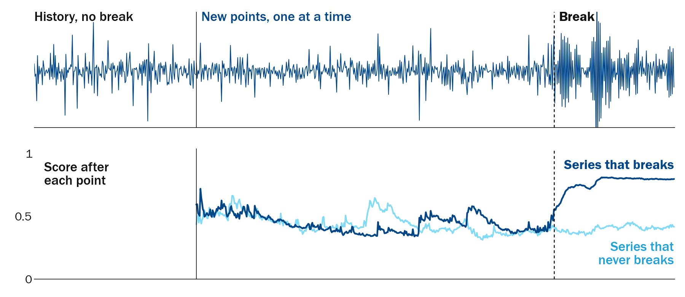
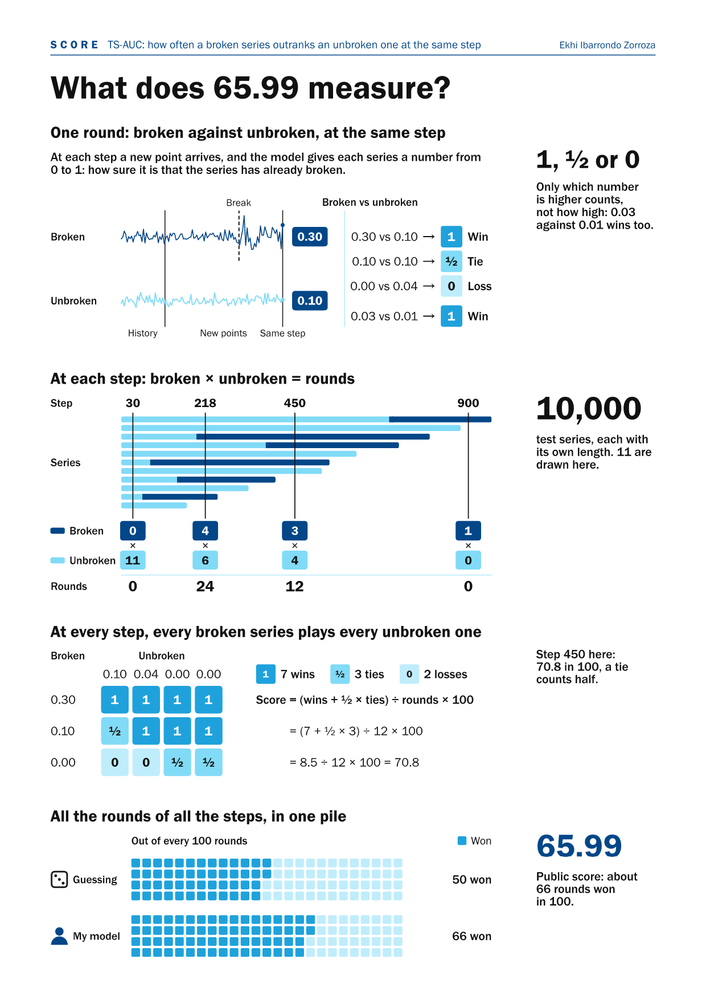
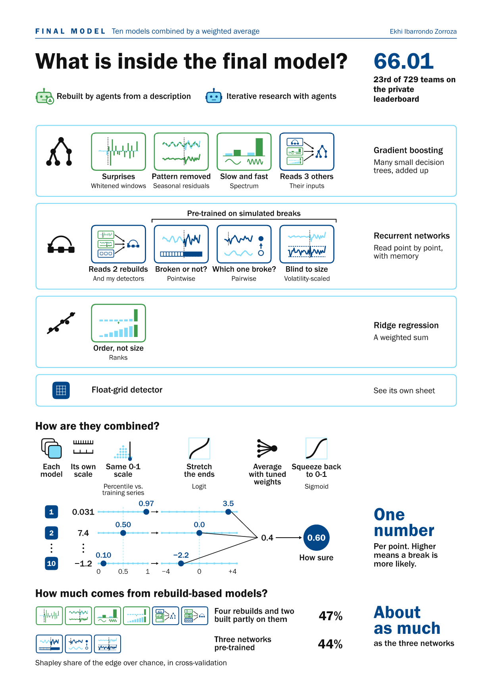
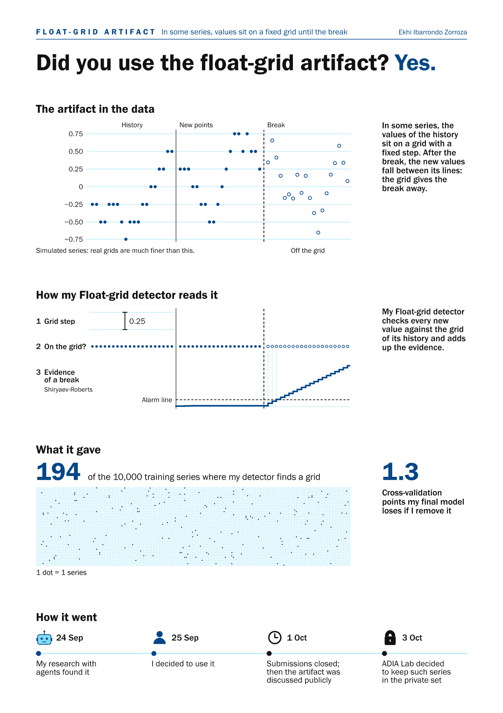
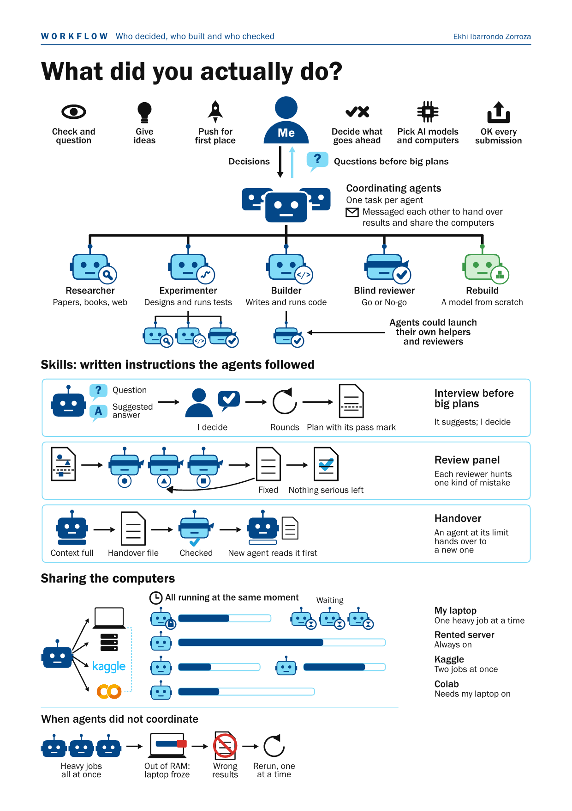

<h1 align="center">Online structural break detection</h1>

<p align="center">
My final model for the <a href="https://hub.crunchdao.com/competitions/structural-break-real-time">ADIA Lab Structural Break Challenge: Real-Time Edition</a> (2026).<br>
<b>23rd of 729 teams in the final ranking, as a solo entry, with 66.01 points, where guessing scores 50.</b><br>
Poster selected for the ADIA Lab Symposium in Abu Dhabi, October 2026.<br>
Ekhi Ibarrondo Zorroza · BSc Finance (Investments), Henley Business School · <a href="https://www.linkedin.com/in/ekhi-ibarrondo">LinkedIn</a>
</p>

<p align="center">
<a href="docs/METHOD.md">Technical write-up</a> ·
<a href="docs/explanatory_sheets.pdf">Poster and sheets (PDF)</a> ·
<a href="https://github.com/ekhi-ibarrondo/online-structural-break-detection/releases/tag/v1.0.0">Model weights</a> ·
<a href="#run-it">Run it</a> ·
<a href="#how-this-was-built">How it was built</a> ·
<a href="#licence-and-citation">Cite</a>
</p>

Ten models read a time series one point at a time and, after each new point, give one score from 0 to 1: how likely it is that the series has already had a structural break, a lasting change in its mean, its volatility, its dependence on the past or the shape of its distribution.

I didn't write any of the code myself. I directed AI agents, each with its own job: some read research papers, some ran experiments, some wrote the code and others reviewed it. My part was to:
- Check and question their work, and give my own ideas
- Pick the AI model and the effort level for each job
- Decide what went ahead and approve every submission

<p align="center"><br>
<sub>The final model scoring two simulated series, chosen for clarity among 40. The dark one breaks: from that point on, each value depends more strongly on the one before, which also makes its swings larger. The light one never breaks.</sub></p>

- **Each series judged against its own past.** Every model compares the new points with the series' own history.
- **Never sees the future.** Each score uses only the history and the points that have arrived so far; a test checks that no score changes when later points are added.
- **Reproducible.** The platform reruns part of every submission and rules out models whose scores change; all 13 of mine passed. The code here gives the same scores as the code I submitted, bit for bit, on 151,820 points ([conditions](docs/METHOD.md#6-reproducibility)).

## The task

Each series has a history with no break; then new points arrive one at a time, and the model never knows how many will come. About half of the series never break. In the training set, histories have 1,000 to 5,000 points and are followed by 10 to 999 new points.

There were three sets of 10,000 series: the **training set**, which participants had; the **public test set**, scored on the platform while the competition was open; and the **private test set**, new data scored once at the end for the final ranking.

## Results

| | Score | Where it comes from |
|---|---|---|
| **Private leaderboard (final ranking)** | **66.01, 23rd of 729 teams** | Private test set |
| 10th place, the last prize | 66.86 | Private test set |
| Public leaderboard | 65.99 | Public test set |
| Local cross-validation | 66.18 | 8,000 of the training series (the other 2,000 held out), grouped by series, 5 folds × 3 seeds |
| Official baseline | 51.45 | Training set |
| Guessing | 50 | |

**What the score means.** It is TS-AUC × 100. At every step, take each pair of one series that has already broken and one that has not. The model wins the pair if it gives the broken series the higher score. My model won about 66 of every 100 pairs; guessing wins 50. No model gets close to 100: many breaks are too small to see.

Over 13 submissions, the public score rose from 53.74 to 65.99.

<p align="center"><a href="docs/figures/score.png"></a><br>
<sub>The sheet uses the public score, 65.99.</sub></p>

## How do I know I didn't overfit?

Overfitting means learning the quirks of the training data instead of the pattern: the model then scores well at home and badly on new data. **The answer came from new data: the private leaderboard gave 66.01, 0.17 below my cross-validation (66.18) and 0.02 above the public score (65.99).**

<p align="center"><a href="docs/figures/validation.png"></a><br>
<sub>Made before the private leaderboard. On the 12 submissions with a cross-validation score, the public score was always below it, by 0.11 to 0.59 points.</sub></p>

- **The 2,000 held-out series** were used only 13 times, 4 of them to adopt or veto a model.
- **Pass marks checked before each run** by a reviewer agent, for most of the project.
- **A frozen scorer.** The scoring code was locked by its hash, a fingerprint of the file, so no experiment could change how it was graded without my approval.
- **Noise twins.** Copies of each new input with its signal destroyed were added as controls. They must leave the score unchanged; in one test they moved it by −0.0003 points.
- **Blind rebuilds.** An agent given a 300-token description of my model at the time, but not its code, rebuilt it and scored 0.85 points higher; a second agent with the same text scored 0.41 higher. That is evidence, not proof, that the score was not an artefact of my code.
- **The data stayed out of the prompts.** The agents ran code on the series and saw only its output, such as scores and summary statistics.

**Limits.**
- The cross-validation of the final model, 66.18, is optimistic: the last models added were chosen on it.
- In the last week, the public leaderboard chose between variants already submitted. The number of comparisons allowed rose from 10 to 16 without tightening the threshold written in advance.
- Four of the ten models [described below](#what-is-inside-the-final-model) entered without meeting their pass mark: Slow and fast, Reads 2 rebuilds, Which one broke? and Blind to size.

## What is inside the final model?

The first four were rebuilt from scratch by AI agents from a written description of the task and of my model, without my code.

| Model | What it looks at | Method |
|---|---|---|
| [Surprises](breakdetect/members/surprises) | How far each new point lands from what the series' own past predicted | Gradient boosting on the residuals of an autoregressive forecast, over several windows |
| [Pattern removed](breakdetect/members/pattern_removed) | The series seen in 9 ways over 5 windows, including what is left after removing its own past and its repeating pattern, plus 18 classic break tests | Gradient boosting; the 9 views include AR(64) and seasonal residuals |
| [Slow and fast](breakdetect/members/slow_and_fast) | Whether the slow or the fast swings of the series change | Gradient boosting on spectral features compared with the series' own history |
| [Order, not size](breakdetect/members/order_not_size) | Where each new point ranks within the series' own history, not how big it is | Ridge regression on 18 detectors computed from each point's rank within the history |
| [Reads 2 rebuilds](breakdetect/members/reads_two_rebuilds) | The inputs of the first two models plus my detectors, read with memory | A supervised recurrent network (GRU) on 354 features |
| [Reads 3 others](breakdetect/members/reads_three_others) | The inputs of Reads 2 rebuilds, Slow and fast, and Order, not size, at once | Gradient boosting (LightGBM) on 468 streaming features |
| [Broken or not?](breakdetect/members/broken_or_not) | The new points, read with memory | A causal GRU pre-trained on breaks inserted into training histories, then fine-tuned on the real labels |
| [Which one broke?](breakdetect/members/which_one_broke) | The same, trained to rank broken above unbroken series at each step | The same architecture, pre-trained on a richer set of simulated breaks, then fine-tuned with a pairwise ranking loss |
| [Blind to size](breakdetect/members/blind_to_size) | The same, with every value divided by a running estimate of volatility | The same architecture on volatility-scaled inputs |
| [Float-grid detector](breakdetect/members/float_grid) | Whether new values fall off the grid that the history sits on | Likelihood ratio of grid membership, added up with a Shiryaev-Roberts statistic |

**How are they combined?** Each model's raw score is turned into a percentile against the training series at the same step. The percentiles are stretched with a logit, averaged with fixed whole-number weights, 27 votes in all, and squeezed back to between 0 and 1 ([`committee.py`](breakdetect/committee.py), [formula](docs/METHOD.md#5-calibration-and-fusion)).

**Where the edge comes from.** Split by Shapley values in cross-validation, the four rebuilds together with the two models that read their inputs carry 47% of the edge over guessing, and the three pre-trained networks 44%: about as much. The float-grid detector carries the rest.

<p align="center"><a href="docs/figures/final_model.png"></a></p>

## Did I use the float-grid artifact? Yes.

In some series, the values of the history sit on a grid with a fixed step. After the break, the new values fall between its lines, so the grid gives the break away. My research with agents found it, and I decided to use it. After submissions closed, the artifact was discussed publicly, and ADIA Lab decided to keep such series in the private set.

The float-grid detector finds a grid in 194 of the 10,000 training series. On series without a grid its score is the same at a given step, so it does not change their order. It has 16 of the 27 votes, but they move only the roughly 2% of series where it finds a grid; removing it from the final model costs 1.3 cross-validation points. Its code is in [`breakdetect/members/float_grid`](breakdetect/members/float_grid) and [`breakdetect/kernels/float_grid.py`](breakdetect/kernels/float_grid.py).

<p align="center"><a href="docs/figures/float_grid.png"></a></p>

## What did not work

- **Most of my own ideas.** About 15 of my ideas for new detectors and ways of combining them failed, most gaining less than 0.3 points.
- **A detector on raw values.** A rebuild's variance detector gained 0.44 points in cross-validation but lost 0.70 on the more persistent half of the series without a break, which it mistook for breaks. Applied to the gap between each new point and what the series' past predicted (whitening), it gained 1.2 and passed.
- **My best cross-validation.** Replacing Slow and fast with another model gave my best cross-validation, 66.23 (submission 12), but scored 0.10 below submission 11 on the public leaderboard, so the final model was built on submission 11.
- **Rebuilds aimed at my model's errors.** Of 11 rebuilds told to focus on the series my model got wrong, none helped (from −0.54 to +0.01 points).

## How this was built

**What I did.** Besides the three things at the top of this page, I pushed for first place and decided which computers ran what. For example, I held back submissions for three weeks until there was a bigger jump, and I decided to use the float-grid detector.

**Who built and who checked.** Coordinating agents turned my decisions into tasks, one per agent, for researchers, experimenters, builders, blind reviewers and rebuild agents, and agents could launch their own helpers and reviewers. Written instructions set how they worked: before a big plan, the agent suggested an answer to each open question and I decided. The work ran on my laptop, a rented server, Kaggle and Colab.

**What went wrong with the agents.**
- I left one agent on the rented server, day and night, to coordinate the others on its own. For several days it produced no results, so I replaced it with a simple script that ran a fixed queue of jobs, one after another, with no agent deciding what came next.
- Reviewers approved plans that still had one-line bugs, so small bugs in the tooling were then fixed on the spot instead of stopping the work.
- Heavy jobs run at the same time ran my laptop out of RAM and gave wrong results; they were rerun one at a time.

<p align="center"><a href="docs/figures/workflow.png"></a></p>

## Run it

Python 3.12 on x86-64; the tests pass on Linux and Windows. The model needs about 2 GB of RAM and scores about 10 ms per point on one CPU core; on the platform, the 10,000 public test series took 3 h 37 min.

```sh
git clone https://github.com/ekhi-ibarrondo/online-structural-break-detection.git
cd online-structural-break-detection
python3.12 -m venv .venv && source .venv/bin/activate
python -m pip install -e .              # the package and its pinned dependencies
python scripts/download_weights.py     # 627 MB from the GitHub Release, checked against MANIFEST.sha256
python scripts/demo.py                 # scores 12 simulated series, about a minute
# ...
# TS-AUC = 0.7620 (76.20 points) on 12 synthetic series
```

To score the series in the figure at the top:

```python
import breakdetect
from breakdetect.synthetic import generate

model = breakdetect.load_model()                  # the downloaded weights, about 25 s
s = generate(n_series=40, seed=3, online_range=(400, 700))[11]   # the series in the figure
scores = model.score(s.history, s.online)         # one score per new point
print(s.kind, s.break_index, scores[431:491:10].round(2))   # every 10th point, from 10 before the break
# dependence 441 [0.4  0.55 0.64 0.73 0.75 0.73]
```

With the competition data (see [Data](#data)), `python -m pip install -e ".[evaluate]"` and then `python scripts/evaluate.py --data-dir /path/to/data` score the 100-series local test set: 61.43. A hundred series are too few for a stable number.

`python -m pip install -e ".[dev]"` and then `python -m pytest` run the tests (about 3 minutes and 4.5 GB of RAM): equivalence with the submitted code, determinism, causality and the metric ([details](docs/METHOD.md#6-reproducibility)).

`main.py` is the entry point in the format the competition's runner expects (`train` and `infer`).

## Data

The competition data cannot be redistributed and is not in this repository. Registered participants can download it from the [CrunchDAO hub](https://hub.crunchdao.com/competitions/structural-break-real-time). Every figure here uses simulated series. The weights include the calibration maps, which were part of the submitted model: for each model and each step, its scores on the training series, sorted, with no series values or ids. Like any model fitted on the training set, they carry information about it; for example, the float-grid map shows when some of the training series with a grid break.

## Repository layout

```
breakdetect/        the model
  members/          one folder per model
  detectors/        streaming change detectors shared by several models
  kernels/          compiled numba kernels, pinned to the same machine code on every x86-64 machine
  calibration.py    raw score → percentile against the training series at the same step
  committee.py      loads the ten models and combines them
main.py             entry point for the competition's runner
scripts/            download_weights.py · demo.py · evaluate.py
tests/              equivalence with the submitted code, determinism, causality, metric
training/           how the weights were trained (needs the competition data; the networks need a GPU)
docs/               technical write-up, poster, sheets and figures
```

## Poster and sheets

[`docs/explanatory_sheets.pdf`](docs/explanatory_sheets.pdf) holds the poster and seven one-page sheets I presented at the ADIA Lab Symposium in Abu Dhabi in October 2026. Made before the private leaderboard, they show public-leaderboard scores (65.99, 24th of 733 on the public leaderboard). Where the poster says "a new detector from my research", it means the float-grid detector of the last sheet.

## Glossary

| Word | Meaning |
|---|---|
| Public / private leaderboard | The ranking on the public test set while the competition was open, and the final ranking on the private test set |
| Cross-validation | Scoring a model on series it was not trained on, in turns, to estimate how it does on new data |
| Folds, seeds | The series are split into 5 groups (folds), each taking a turn as the test set; each seed is a different random split |
| Gradient boosting | Many small decision trees, each one correcting the ones before it |
| Recurrent network (GRU) | A neural network that reads a sequence point by point and keeps a memory of what it has seen |
| Pre-trained, fine-tuned | Trained first on a related task (here, breaks inserted into training histories), then trained further on the real labels |
| Ridge regression | A weighted sum whose weights are kept small so they do not chase noise |
| Rebuild | A model built from scratch by an AI agent from a written description, without my code |
| Shiryaev-Roberts statistic | A classic statistic that adds up evidence of a change one point at a time |

## Licence and citation

Code and model weights: [MIT](LICENSE). Figures and documentation: [CC BY 4.0](https://creativecommons.org/licenses/by/4.0/), except the logos of other companies in the workflow sheet, which belong to their owners. Third-party notices are in [THIRD_PARTY_NOTICES.md](THIRD_PARTY_NOTICES.md). To cite this work, use the "Cite this repository" button, [CITATION.cff](CITATION.cff) or:

```bibtex
@software{ibarrondo2026onlinebreaks,
  author  = {Ibarrondo Zorroza, Ekhi},
  title   = {Online structural break detection: my final model for the ADIA Lab Structural Break Challenge: Real-Time Edition (2026)},
  year    = {2026},
  version = {1.0.0},
  url     = {https://github.com/ekhi-ibarrondo/online-structural-break-detection}
}
```

Thanks to ADIA Lab and CrunchDAO for the challenge and the symposium.

## Contact

Ekhi Ibarrondo Zorroza · [LinkedIn](https://www.linkedin.com/in/ekhi-ibarrondo)
