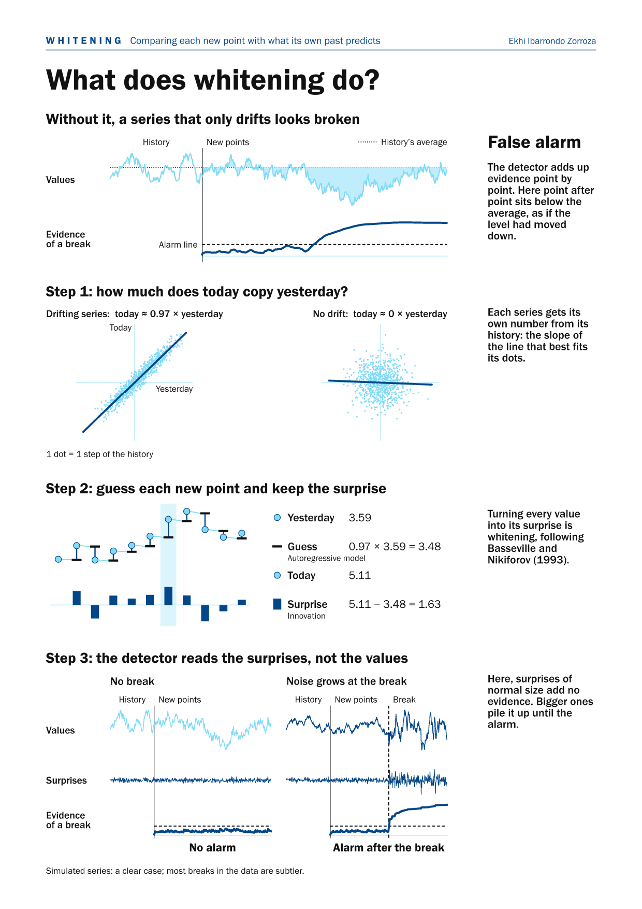
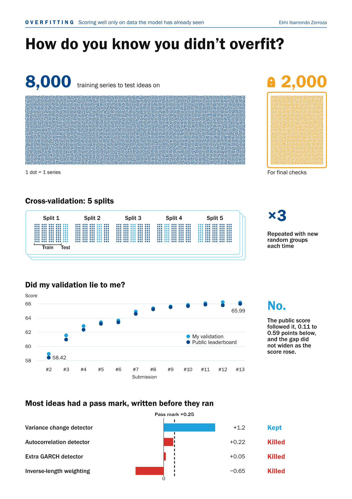
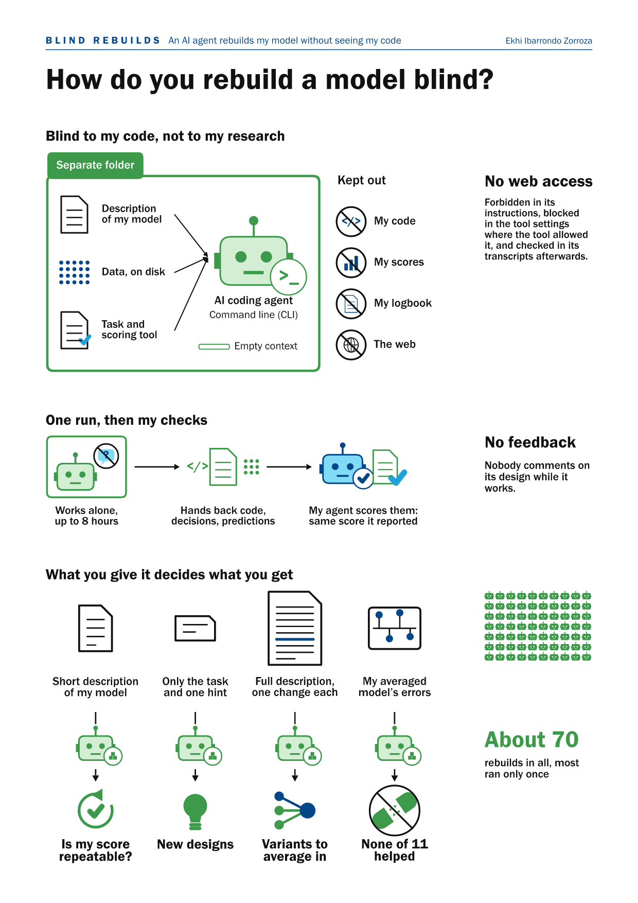

# Technical write-up

The detailed version of the [README](../README.md). Scores are in leaderboard points (TS-AUC × 100), and "CV" means cross-validation on 8,000 of the 10,000 training series (the other 2,000 were held out), grouped by series, 5 folds × 3 seeds, unless stated otherwise. A "±" is a paired standard error over 16 blocks of series (block means averaged over the 3 seeds), so it reflects the variation between series, not only between seeds.

**In short.**
- Every series is judged against its own past: AR whitening and ranks against the history, and detectors z-scored against null streams cut from the same history.
- Sequential detectors (FOCuS, CUSUM, Shiryaev-Roberts mixtures, GARCH scores) feed gradient boosting, a ridge regression and a supervised GRU; three more GRUs are pre-trained without labels on breaks inserted into training histories, then fine-tuned.
- Each member's raw score becomes a percentile against the training series at the same step; the committee averages them in log-odds with fixed integer weights.
- The code gives the same bits as the submitted code on x86-64 Linux without AVX-512, checked on 151,820 points.
- 66.01 on the private leaderboard (new data), 65.99 on the public one, 66.18 in CV.

## 1. The problem

Each series has a history $x_1, \dots, x_n$ with no break ($n$ between about 1,000 and 5,000) and an online segment $y_1, \dots, y_T$ ($T$ between about 10 and 999) that arrives one point at a time. A break, if there is one, happens at an online step $\tau$; the label of step $t$ is $1$ for $t \ge \tau$ and $0$ before. About half of the series have a break, and $\tau$ is uniform. After receiving $y_t$, and before seeing $y_{t+1}$, the model must output a score $s_t \in [0, 1]$. It never knows $T$.

In the competition's public webinars, the organisers describe the breaks as built by splicing segments from different sources, so a break can change the mean, the variance, the serial dependence or the shape of the distribution. In the training set, more than half of the series are non-Gaussian and about half show volatility clustering (ARCH effects).

## 2. The metric

TS-AUC pools, over all online steps, every pair of one positive point (a series that has already broken at step $t$) and one negative point (a series that has not) at the same step:

```math
\mathrm{TS\text{-}AUC} = \frac{\sum_t \sum_{i \in P_t} \sum_{j \in N_t} \left( \mathbb{1}[s_{i,t} > s_{j,t}] + \tfrac{1}{2}\mathbb{1}[s_{i,t} = s_{j,t}] \right)}{\sum_t |P_t|\,|N_t|}
```

Three consequences shaped the design:

- **Only the ranking between series at the same step matters.** Calibration across steps is irrelevant, and ties cost half a pair each.
- **Steps are weighted by $`|P_t|\,|N_t|`$.** On the training set most of the weight lies between steps 90 and 600 and peaks near step 218, so very early detection and very late breaks count little.
- **The ideal score is the posterior probability of a break** given the history and the points so far. With known laws before and after the break and a flat prior on its time, this posterior is a monotone function of a Shiryaev-Roberts statistic mixed over the break types (Tartakovsky, Nikiforov and Basseville, 2014); the model approximates it with learned members.

[`breakdetect/metrics.py`](../breakdetect/metrics.py) implements the formula and is tested against a pair-by-pair count.

## 3. Design

**Judge each series against its own past.** Series differ a lot in level, scale and autocorrelation, so a threshold shared by all series is wrong for most of them. Every member compares the new points with the history of the same series, in three ways:
- the variance detectors run the same statistics on null streams cut from the series' own history (at shifted starting points) and report how far the real stream is from them, as a z-score ([`kernels/variance.py`](../breakdetect/kernels/variance.py));
- the networks subtract from their output a share of what they output on pseudo-online windows cut from the end of the history, so a series that always looks "broken" to them is corrected ([`members/sequence_net.py`](../breakdetect/members/sequence_net.py));
- Pattern removed turns its detector columns into ranks within cells of step and history length.

**Whiten first.** A slowly drifting series departs from its average without any break. So the history is fitted with an autoregressive model, and each new point is replaced by its innovation: the gap between the point and what its past predicted (Basseville and Nikiforov, 1993). Values and innovations are also turned into ranks against the history (probability integral transform), which keeps heavy tails from dominating.

<p align="center"><a href="figures/whitening.png"></a></p>

**Add up the evidence one point at a time.** The detectors are sequential statistics updated in bounded time per point: FOCuS for changes in mean and variance (Romano et al., 2023), CUSUM statistics, Shiryaev-Roberts mixtures over change sizes, tests on GARCH(1,1) scores fitted on the history, distribution-shape statistics on quantiles and Hermite polynomials, and spectral energies.

**Learn the mixture.** Supervised models learn how to weigh the detectors and features at each step. Training weights follow the metric: a positive point at step $t$ weighs $|N_t|$ and a negative one weighs $|P_t|$, so each step counts as much as its pairs.

**Diversity from blind rebuilds.** Four of the members were rebuilt from scratch by AI agents that received a written description of the task and of an earlier model, plus one mandatory change each, and never the code. Implementations of the same description differ, as with human teams given the same data (Menkveld et al., 2024), so their errors differ, and averaging models with similar scores and different errors gains more than any one of them.

## 4. The ten members

| Member | Inputs at each step | Learner |
|---|---|---|
| Surprises | Window statistics of the AR innovations, standardised by the history, and CUSUM statistics | Gradient boosting (LightGBM), three seeds, each one pooled model |
| Pattern removed | 9 transformations (level, energy, seasonal and AR(64) residuals, lag-1 products, differences…) over 5 windows, plus 18 detector columns ranked per step and history length | Gradient boosting (LightGBM) |
| Slow and fast | Spectral statistics (short-time Fourier transform, Haar wavelets, cepstrum) compared with the series' own history | Gradient boosting (LightGBM) |
| Order, not size | 18 detectors computed on ranks against the history, with interaction terms | Closed-form weighted ridge regression |
| Reads 3 others | 468 streaming features: the inputs of Reads 2 rebuilds plus those of Slow and fast and Order, not size | Gradient boosting (LightGBM) |
| Reads 2 rebuilds | 354 features: the inputs of Surprises and Pattern removed, 36 summary features, 22 detector traces and 4 context values | Supervised 2-layer GRU, 3 learners averaged in logit |
| Broken or not? | 9 channels per step, built from the AR(5) innovation, its rank and absolute value, a step clock, constants of the history, and the standardised level and its rank | Causal 2-layer GRU, pre-trained without labels on breaks inserted into training histories (pieces of other series and synthetic changes of mean, variance, dependence and tails), then fine-tuned on the labels: linear probing first, then the whole network (Kumar et al., 2022) |
| Which one broke? | The same | The same architecture, a richer pre-training task, fine-tuned with a pairwise ranking loss within each step |
| Blind to size | The same channels, computed on the series divided by a running estimate of volatility | The same architecture |
| Float-grid detector | Each new value against the grid of values that the history sits on | No supervised training: log-likelihood ratio of grid membership, accumulated with a Shiryaev-Roberts statistic |

The three pre-trained networks were trained on the 8,000 cross-validation series only, never on the 2,000 held out. In a pilot on a smaller prototype (one fold), pre-training clearly beat training it from scratch.

## 5. Calibration and fusion

Raw scores of different members are not comparable, so each member $m$ is calibrated **per step**. Its raw score $r_{m,t}$ at online step $t$ becomes a percentile through the empirical CDF of its out-of-fold (or training) scores at that step (steps beyond 999 use the map of step 999). It is a percentile, not a probability of a break: it only has to rank series correctly at each step. A member with several maps (one per training seed) averages them:

$$p_{m,t} = \hat F_{m,t}(r_{m,t})$$

The committee averages the members in log-odds space with fixed integer weights $w_m$ and maps the mean back to $[0, 1]$:

```math
s_t = \sigma\!\left( \frac{1}{W} \sum_m w_m \,\mathrm{logit}(p_{m,t}) \right), \qquad W = \sum_m w_m
```

where $\sigma$ is the logistic function, each $p_{m,t}$ is clipped to $[10^{-6}, 1 - 10^{-6}]$ and $s_t$ is clipped to $[10^{-9}, 1 - 10^{-9}]$ and rounded to float32. The final score ranks series at each step; it is not a calibrated probability.

**Why log-odds.** Averaging log-odds instead of percentiles lets a member that is far in a tail outweigh several members near the middle, much as independent pieces of evidence add up in a log-likelihood ratio.

**The weights.** They were built up step by step: each candidate member or weight change was measured in CV and kept or dropped by my decision; in the final week, the public leaderboard chose between variants already submitted (see §7). They are in `committee.json`, inside the weights. The float-grid detector has 16 of the 27 votes and each of the other members 1 or 2. On a series without a grid, the float-grid detector's score is the same for every series at a given step, so it does not change their order; it only moves the roughly 2% of series where it finds a grid.

**Out-of-fold scores.** The CV of every member, the networks included, comes from fold models trained on four fifths of the series. The shipped members were then refitted on all their training series, and their maps were fitted on out-of-fold scores where they existed and on training scores otherwise. A map is monotone, so this does not change the order of a member's own scores, only its weight in the mean. A member that fails on a series is dropped for the rest of that series and the remaining weights still form the mean; two of the networks switch to fixed fallback values instead. See [`breakdetect/calibration.py`](../breakdetect/calibration.py) and [`breakdetect/committee.py`](../breakdetect/committee.py).

## 6. Reproducibility

The platform reruns the first 10% of the test series inside the same run and compares the two outputs with `allclose`; a model whose scores differ is marked non-deterministic and cannot win a prize. All 13 submissions passed. The code goes further and aims at identical bits:

- **Every series is processed on its own.** No state is shared between series, and the length of the online segment is never used.
- **Compiled kernels are pinned.** The numba kernels are compiled for the generic x86-64 CPU, without Intel's SVML and with one thread, so every x86-64 machine runs the same machine code for them. Their `log`, `exp` and similar calls still go to the operating system's maths library, and the numpy code outside the kernels may pick different vector instructions on other processors, so identical bits are only checked on the machine type below. On Windows the 20 test series agree to within $10^{-5}$ (the test allows $10^{-4}$ there). BLAS is limited to one thread, because a multi-threaded sum adds numbers in a different order on each run.
- **Portable maths where it matters.** The ridge member's `log`, `exp` and `erfc` are ports of fdlibm written with basic IEEE operations, and its sums run in a fixed order with compensation, so they do not depend on the platform's maths library.

Before this release, the cleaned-up code was checked against the code that was submitted on 151,820 points (the 100 local test series, 200 simulated series and some edge cases): the scores are identical, bit for bit, on x86-64 Linux (a processor without AVX-512) with Python 3.12 and the pinned versions. The tests repeat this check on 20 simulated series: bit for bit on that machine type, and within $10^{-4}$ on Windows and on processors with AVX-512. They also check that two fresh processes give the same bits, that no score changes when later points are added, and that the TS-AUC matches a pair-by-pair count.

**Speed.** About 10 ms per point on one core after a 25-second load, with about 2 GB of RAM per process. The final run on the platform's 10,000 public test series took 3 h 37 min on 16 virtual CPUs with 6 worker processes.

## 7. Validation

- **Cross-validation grouped by series**, 5 folds × 3 seeds, from the first supervised model.
- **A held-out fifth.** From 21 August, 2,000 of the 10,000 training series were locked away for final checks and read only 13 times in total.
- **A frozen scorer.** From 21 August the scoring code was locked by its hash.
- **Pass marks written in advance.** For most of the project, each experiment had a written plan with its kill criteria, checked by a blind reviewer agent before it ran. From 21 August, each gain was also compared with two paired standard errors (later kept only as a record); in the final week a fixed Bonferroni rule decided adoptions.
- **Built-in controls in each pre-registered experiment:**
  - an exact replica of the reference score, to 16 digits, before measuring anything new;
  - noise twins, copies of the new columns with their signal destroyed, which must leave the score unchanged;
  - a persistence split: the series without a break are split into more and less persistent halves, and a gain may not come from hurting the persistent half;
  - a check by break type: the gain may not come with significant damage on any one type of break;
  - a duplicate check against existing columns.
- **Blind rebuilds.** Following the compression test of Bertran, Roth and Wu (2026), on 22 August an agent given a 300-token description of my model at the time (59.04 in CV on all 10,000 series), the training data and the scoring tool, but no code, rebuilt it from scratch and scored 0.85 points higher on the same 10,000 series; a second agent with the same text scored 0.41 higher. The gap came almost entirely from detectors they built differently. That is evidence, not proof, that the score was not an artefact of my code: it rules out bugs specific to my code, not leakage shared by the data split or the scorer. Both ran the day after the held-out fifth was set aside and still used all 10,000 series; from the next rounds on, rebuild agents never received the held-out series.

<p align="center"><a href="figures/validation.png"></a> <a href="figures/blind_rebuilds.png"></a></p>

**Limits.**
- The CV of the final model, 66.18, is optimistic, because its composition was chosen on that same CV.
- In the last week, the public leaderboard chose between variants that had already been submitted, with a one-sided Bonferroni threshold written in advance; the number of comparisons it allowed was later raised without tightening the threshold.
- Some members entered the final model without meeting their pass mark.

## 8. Results

The final model scored 66.01 on the private leaderboard (new data, 23rd of 729 teams), 65.99 on the public one and 66.18 in CV (optimistic); the official baseline scores 51.45 on the training set, and guessing 50. On every one of the 12 trained submissions, the public score was below the CV, by 0.11 to 0.59 points (mean 0.31). For the first three of them, the CV used all 10,000 series.

**Where the edge comes from** (cross-validation on the 8,000 series, Shapley values over three groups of members): the four rebuilds together with the two models that read their inputs carry 47% of the edge over guessing, the three pre-trained networks 44%, and the float-grid detector the rest. The difference between the first two groups is not conclusive (1.6 standard errors).

| Group | Alone | Cost of removing it from the final model |
|---|---|---|
| The three pre-trained networks | 63.61 | 0.68 ± 0.12 |
| The two models trained partly on the rebuilds | 63.89 | 0.32 ± 0.07 |
| The four rebuilds | 63.53 | 0.05 ± 0.09 |
| The float-grid detector | 52.01 | 1.31 ± 0.15 |
| The first three groups together | 64.87 | |

These are out-of-fold scores of the fold models, not of the shipped weights, and each group keeps its internal weights, which penalises the groups alone. Removing a group measures only what the rest cannot replace: the two stacked models read the rebuilds' features, so removing the rebuilds alone costs little. The float-grid detector fires on about 2% of the series, so it is weak alone and strong in the committee.

## 9. What did not work

| Idea | What happened |
|---|---|
| About 15 new detector families and combiner variants (mid-August to early September) | Most gained less than 0.3 points in CV. One gained 0.33 but failed the persistence split by 0.01, and its fix kept only 0.07 |
| A variance detector built by a rebuild, on raw values | +0.44 in CV, but −0.70 on the persistent half of the series without a break: rejected. Whitened first, it gained 1.19 and passed |
| Gradient boosting instead of the ridge to combine the detectors | 55.49 against 55.65 for the ridge |
| Rebuilds briefed without any architecture | 3 of 3 failed, from −1.5 to −5.7 against the model of the time |
| Rebuilds aimed at the committee's errors | None of 11 helped (from −0.54 to +0.01) |
| Distilling the committee into one model | 9 measurements, no gain |

## References

- Basseville, M. and Nikiforov, I. V. (1993). *Detection of Abrupt Changes: Theory and Application*. Prentice Hall.
- Tartakovsky, A., Nikiforov, I. and Basseville, M. (2014). *Sequential Analysis: Hypothesis Testing and Changepoint Detection*. CRC Press.
- Romano, G., Eckley, I. A., Fearnhead, P. and Rigaill, G. (2023). Fast online changepoint detection via functional pruning CUSUM statistics. *Journal of Machine Learning Research* 24(81).
- Bertran, M. A., Roth, A. and Wu, Z. S. (2026). What Fits (Into Few Tokens) Doesn't Overfit: Compression and Generalization in ML Research Agents. arXiv:2606.11045.
- Menkveld, A. J. et al. (2024). Nonstandard Errors. *Journal of Finance* 79(3), 2339-2390.
- Kumar, A. et al. (2022). Fine-tuning can distort pretrained features and underperform out-of-distribution. ICLR 2022.

More references, with the code they relate to, are in [THIRD_PARTY_NOTICES.md](../THIRD_PARTY_NOTICES.md).
